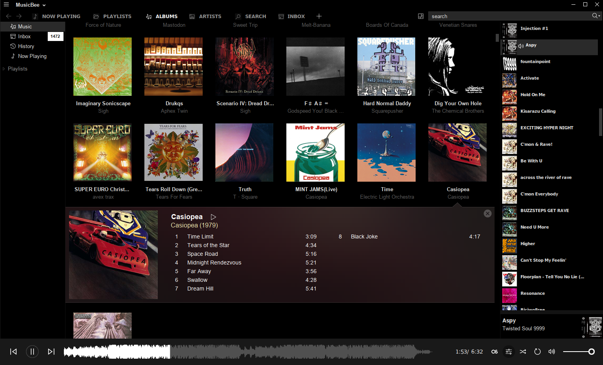

# MusicBee on Linux

[MusicBee](https://getmusicbee.com/) is one of the best music players and library managers out there. This project installs and runs it on Linux with Wine, including most of the known tweaks to integrate and get MusicBee running smoothly.

Packages are available for Ubuntu, Debian, Fedora and Arch Linux. You can also install manually on other distributions.



## Installing

Choose your distribution, then [finish the installation](#finish-installation).

### Fedora

```bash
sudo dnf config-manager addrepo \
  --from-repofile=https://fiso64.github.io/musicbee-linux/musicbee.repo

sudo dnf install musicbee
```

### Ubuntu

```bash
sudo wget -O /etc/apt/sources.list.d/musicbee.sources \
  https://fiso64.github.io/musicbee-linux/musicbee.sources
sudo apt update

sudo apt install musicbee
```

### Debian 13 (amd64)

Enable `contrib` in your [Debian package sources](https://wiki.debian.org/SourcesList) for Winetricks. Then:

```bash
sudo dpkg --add-architecture i386
sudo wget -O /etc/apt/sources.list.d/musicbee.sources \
  https://fiso64.github.io/musicbee-linux/musicbee.sources
sudo apt update
sudo apt install musicbee wine32:i386
```

If you already use WineHQ, install `musicbee` without `wine32:i386`; WineHQ supplies its own 32-bit Wine components. `contrib` is still needed for Winetricks.

### Arch Linux

```bash
curl -fsSLo /tmp/musicbee-signing-key.asc https://fiso64.github.io/musicbee-linux/RPM-GPG-KEY-musicbee
sudo pacman-key --add /tmp/musicbee-signing-key.asc
sudo pacman-key --lsign-key 32D14FD049B362CCB5385821860F6C0D383A2FA4

sudo sh -c 'cat >> /etc/pacman.conf' <<'EOF'

[musicbee-linux]
SigLevel = Required TrustedOnly
Server = https://fiso64.github.io/musicbee-linux/arch
EOF

sudo pacman -Syu musicbee
```

### Manual install

Install Python, Wine, Winetricks, cabextract, icoutils, 7-Zip and Zenity using your distribution's package manager. Then:

```bash
git clone https://github.com/fiso64/musicbee-linux.git
cd musicbee-linux
```

### Finish installation

Download the **Portable Edition** from the [MusicBee download page](https://www.getmusicbee.com/downloads/), then run:

```bash
musicbee-manage install ~/Downloads/MusicBeePortable_*.zip
```

For manual installs, run `python3 src/musicbee-manage.py install ~/Downloads/MusicBeePortable_*.zip` from the cloned directory instead. This installs the commands in `~/.local/bin`; add it to your PATH if needed.

### Media controls

Linux media controls require Wine with the AF_UNIX support used by MPRISBee. Wine Staging includes it, and some distributions' Wine builds do too.

If media controls don't work, try Wine Staging. (For example, on Ubuntu/Debian, see [WineHQ's installation guide](https://gitlab.winehq.org/wine/wine/-/wikis/Debian-Ubuntu)). Select it with `musicbee-manage config wine staging`.

## Usage

### Your music

Wine normally makes `~/Music` available in MusicBee's default Music folder (`C:\Users\yourusername\Music`). To use another folder, close MusicBee and run:

```bash
musicbee-manage music-dir /path/to/music --wine-music-path 'C:\MyMusic'
```

### Using external tools

To send tracks to a native Linux application, register its command:

```bash
musicbee-manage tools add picard 'flatpak run org.musicbrainz.Picard'
```

Then add the printed path in the MusicBee Tools configuration as usual.

### MusicBee command line

`musicbee` accepts MusicBee's usual command-line options, including when it is
already running. Linux file and folder paths are translated to Wine paths (Windows paths also work).

```bash
musicbee ~/Music/song.flac
musicbee /QueueNext ~/Music/playlist.m3u
musicbee /Next
musicbee --help   # View all options
```

See MusicBee's [documented options](https://getmusicbee.com/forum/index.php?topic=6885.0).

## Tweaks & troubleshooting

This package already includes most of the known tweaks to get MusicBee running smoothly:

- CJK fonts and other dependencies
- BASS AAC decoder for AAC and M4A playback
- MPRISBee for Linux media controls
- Native file-manager integration
- A workaround for the crashing file converters tab

Additional optional tweaks can be listed with `musicbee-manage config`. If you're having issues, look here first. Example usage:

```bash
musicbee-manage config                    # list all settings
musicbee-manage config gdiplus            # describe a setting
musicbee-manage config audio-latency on   # example: sometimes useful against stuttering
```

For desktop launch problems, check `~/.local/share/musicbee/desktop-launch.log` (or `$XDG_DATA_HOME/musicbee/desktop-launch.log`). For more Wine diagnostics when launching from a terminal, run `WINEDEBUG=warn+all musicbee`. Please include `musicbee-manage --version` output when opening issues.

<details>
  <summary><b>Known problems</b></summary>

### Dragging tabs to rearrange them fails
Close MusicBee, then list and rearrange the saved tabs:

```bash
musicbee-manage tabs       # list tabs in their current order
musicbee-manage tabs 3 1   # move tab 3 to the first position
```

### Some skins have broken/ugly window borders or missing min/max/close buttons

Try enabling or disabling `View > Skins > Skin Window Borders`. Unfortunately, there is no confirmed solution that works for every skin.

</details>

## Updating MusicBee, installing plugins

To update MusicBee itself, close it, download a newer Portable archive and run:

```bash
musicbee-manage install ~/Downloads/MusicBeePortable_*.zip
```

or just extract the contents to the MusicBee install location.

Installing plugins works as usual: Just follow their normal install process.

## Uninstalling

Uninstalling this package leaves MusicBee and its settings in place. You can delete its Wine prefix at `~/.local/share/musicbee/wineprefix` to remove them.

```bash
# Fedora
sudo dnf remove musicbee

# Ubuntu
sudo apt remove musicbee

# Arch Linux
sudo pacman -R musicbee

# Manual installs
rm -f ~/.local/bin/musicbee ~/.local/bin/musicbee-manage ~/.local/share/applications/musicbee.desktop
```

## Credits

- Steven Mayall, for [MusicBee](https://getmusicbee.com/).
- Kyletsit and UrbanCMC, for [MPRISBee and its fork](https://github.com/UrbanCMC/mb_MPRISBee), which provide Linux media integration.

## License

This Linux integration is licensed under [GPL-3.0-only](LICENSE). MusicBee is
distributed separately under its own license.

