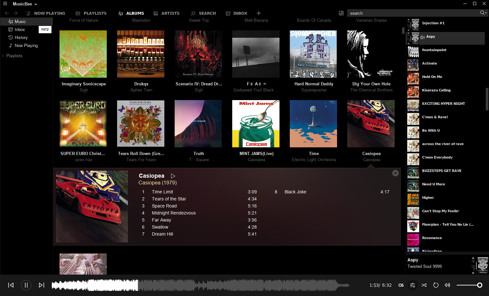

# MusicBee on Linux

[MusicBee](https://getmusicbee.com/) is one of the best music players and library managers out there. This project installs and runs it on Linux with Wine, including most of the known tweaks to integrate and get MusicBee running smoothly. Note that MusicBee is not officially supported on Linux.

Packages are available for Ubuntu, Debian, Fedora and Arch Linux. You can also install manually on other distributions.



## Installing

Choose your distribution below. The installer downloads MusicBee Portable from our [mirror](https://github.com/fiso64/musicbee-portable).

### Fedora

```bash
sudo dnf config-manager addrepo \
  --from-repofile=https://fiso64.github.io/musicbee-linux/musicbee.repo

sudo dnf install musicbee

musicbee-manage install
```

### Ubuntu

```bash
sudo wget -O /etc/apt/sources.list.d/musicbee.sources \
  https://fiso64.github.io/musicbee-linux/musicbee.sources
sudo apt update

sudo apt install musicbee

musicbee-manage install
```

### Debian 13 (amd64)

Enable `contrib` in your [Debian package sources](https://wiki.debian.org/SourcesList) for Winetricks. Then:

```bash
sudo dpkg --add-architecture i386
sudo wget -O /etc/apt/sources.list.d/musicbee.sources \
  https://fiso64.github.io/musicbee-linux/musicbee.sources
sudo apt update
sudo apt install musicbee wine32:i386

musicbee-manage install
```

If you already use WineHQ, install `musicbee` without `wine32:i386`; WineHQ supplies its own 32-bit Wine components.

### Arch Linux

```bash
curl -fsSLo /tmp/musicbee-signing-key.asc https://fiso64.github.io/musicbee-linux/RPM-GPG-KEY-musicbee
sudo pacman-key --add /tmp/musicbee-signing-key.asc
sudo pacman-key --lsign-key 32D14FD049B362CCB5385821860F6C0D383A2FA4

sudo sh -c 'cat >> /etc/pacman.conf' <<'EOF'

[musicbee-linux]
SigLevel = Required TrustedOnly
Server = https://fiso64.github.io/musicbee-linux/arch
EOF

sudo pacman -Syu musicbee

musicbee-manage install
```

### Manual install

Install Python, Wine, Winetricks, cabextract, icoutils, 7-Zip and Zenity. Then:

```bash
git clone https://github.com/fiso64/musicbee-linux.git
cd musicbee-linux
python3 src/musicbee-manage.py install
```

This installs the commands in `~/.local/bin`; add it to your PATH if needed.

### Other MusicBee versions

To choose a different version or use your own downloaded Portable ZIP or EXE:

```bash
musicbee-manage versions
musicbee-manage install --version 3.6.9403.32563
musicbee-manage install --archive ~/Downloads/MusicBeePortable.zip
```

### Media controls

Linux media controls require Wine with the AF_UNIX support used by MPRISBee. Wine Staging includes it, and some distributions' Wine builds do too.

If media controls don't work, try Wine Staging. (For example, on Ubuntu/Debian, see [WineHQ's installation guide](https://gitlab.winehq.org/wine/wine/-/wikis/Debian-Ubuntu)). Select it with `musicbee-manage config wine staging`.

## Usage

### Your music

Wine normally makes `~/Music` available in MusicBee's default Music folder (`C:\Users\yourusername\Music`). To use another folder, close MusicBee and run:

```bash
musicbee-manage music-dir /path/to/music --wine-music-path 'C:\MyMusic'
```

### Using external tools

To send tracks to a native Linux application, register its command:

```bash
musicbee-manage tools add picard 'flatpak run org.musicbrainz.Picard'
```

Then add the printed path in the MusicBee Tools configuration as usual.

### MusicBee command line

`musicbee` accepts MusicBee's usual command-line options, including when it is
already running. Linux file and folder paths are translated to Wine paths (Windows paths also work).

```bash
musicbee ~/Music/song.flac
musicbee /QueueNext ~/Music/playlist.m3u
musicbee /Next
musicbee --help   # View all options
```

See MusicBee's [documented options](https://getmusicbee.com/forum/index.php?topic=6885.0).

## Troubleshooting

See [troubleshooting and known problems](docs/troubleshooting.md).

Feel free to [open an issue](https://github.com/fiso64/musicbee-linux/issues) (or create a PR!) when you think the problem is specific to the Linux integration. Please include the output of `musicbee-manage --version`.

## Updating MusicBee, installing plugins

To update MusicBee itself, close it and run:

```bash
musicbee-manage install --update
```

You can also choose a version or use a local archive as shown above.

Installing plugins works as usual: Just follow their normal install process.

## Uninstalling

Uninstalling this package leaves MusicBee and its settings in place.

```bash
# Fedora
sudo dnf remove musicbee

# Ubuntu
sudo apt remove musicbee

# Arch Linux
sudo pacman -R musicbee

# Manual installs
rm -f ~/.local/bin/musicbee ~/.local/bin/musicbee-manage ~/.local/share/applications/musicbee.desktop
```

To remove MusicBee (along with its data and settings) completely, delete its Wine prefix at `~/.local/share/musicbee/wineprefix`

## Credits

- Steven Mayall, for [MusicBee](https://getmusicbee.com/).
- Kyletsit and UrbanCMC, for [MPRISBee and its fork](https://github.com/UrbanCMC/mb_MPRISBee), which provide Linux media integration.

## License

This Linux integration is licensed under [GPL-3.0-only](LICENSE). MusicBee is
distributed separately under its own license.

